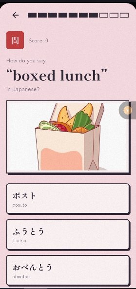
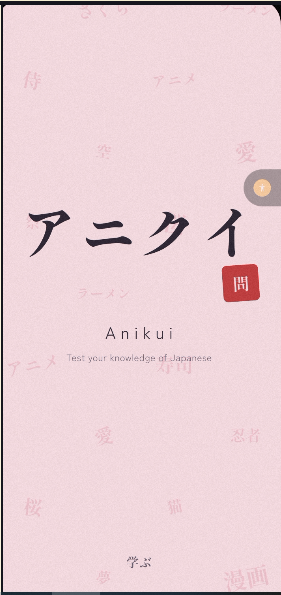
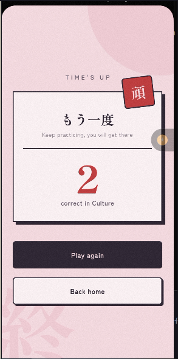

# Anikui

A Japanese quiz app I built with Flutter. You pick a section, you get 60 seconds, and you answer as many questions as you can. It covers vocabulary, anime, food and culture, so it's a bit of learning and a bit of fun at the same time.

I built it because I just felt like...

## Download

Grab the APK from the [ReleasePage]([https://anilist.co](https://github.com/Tosin2510/anikui/releases/tag/v1.0.0)), and install it on your Android phone. 
Not sure which one to pick? download `app-arm64-v8a-release.apk`, it works on almost all modern phones. Also, allow your phone to install from unknown sources.

## How it works

Four sections are available.

- **Vocabulary**: "How do you say this in Japanese?" using N5 words. Some words come with a picture, some do not. I used Pollinations to generate the images.
- **Anime**: guess the anime from its cover, guess the character, guess the anime from its description, or guess how many episodes an anime has.
- **Food**: Japanese food questions basically....
- **Culture**: Questions on customs, festivals, etiquette and so on.

The anime section needs internet, so it's blurred out on the home screen if there is no internet. The other three work without internet.

## Where the data comes from

- Anime data comes from [AniList](https://anilist.co), the images for the questions also come from there.
- The vocabulary list comes from the N5 set in the openjlpt dataset. I wrote a python script to clean up the data and another one to generate the images. The images for vocabulary questions are AI generated with [Pollinations](https://pollinations.ai).
- Food and culture questions are hardcoded into the app.

## Built with

Flutter and Dart and other stuffs

- http for calling the AniList API
- connectivity_plus to check if the device is online
- google_fonts for the fonts

## Running it from source

You need the Flutter SDK.

1. `git clone https://github.com/Tosin2510/anikui.git`
2. `cd anikui`
3. `flutter pub get`
4. Connect a device or start an emulator and run `flutter run`

## Things that don't work well yet

- The anime section needs internet.
- The vocabulary question images are AI generated, so for abstract words (or words that cannot exactly be pictured), they may feel off.
- Users can only see the score for the quiz they just finished playing.

## License

MIT License

## Some screenshots

